# Entity-relationship diagram

> **Generated** by `scripts/database/generate_er_diagram.py` from the SQLAlchemy models. Do not edit by hand; CI fails if this file is stale.

Entities show their primary and foreign key columns only; the full column list, constraints and owning module of every table are in [data-dictionary.md](data-dictionary.md). A relationship line means a foreign key: the parent side is `||` (exactly one) or `|o` (a nullable foreign key means the parent is optional); the child side is `o{` (zero or more).

```mermaid
erDiagram
    anomaly_alerts {
        uuid facility_id FK
        uuid material_category_id FK
        uuid acknowledged_by_id FK
        uuid id PK
    }
    audit_logs {
        uuid actor_id FK
        uuid id PK
    }
    auth_sessions {
        uuid user_id FK
        uuid id PK
    }
    classification_model_versions {
        uuid id PK
    }
    classification_predictions {
        uuid media_asset_id FK
        uuid model_version_id FK
        uuid material_category_id FK
        uuid reviewed_material_category_id FK
        uuid reviewed_by_id FK
        uuid id PK
    }
    collection_assignments {
        uuid collection_task_id FK
        uuid assignee_id FK
        uuid vehicle_id FK
        uuid assigned_by_id FK
        uuid id PK
    }
    collection_events {
        uuid collection_task_id FK
        uuid recorded_by_id FK
        uuid facility_id FK
        uuid id PK
    }
    collection_task_status_history {
        uuid collection_task_id FK
        uuid changed_by_id FK
        uuid id PK
    }
    collection_tasks {
        uuid waste_report_id FK
        uuid destination_facility_id FK
        uuid created_by_id FK
        uuid id PK
    }
    community_incidents {
        uuid reporter_id FK
        uuid assigned_to_id FK
        uuid photo_media_asset_id FK
        uuid id PK
    }
    custody_events {
        uuid material_passport_id FK
        uuid actor_id FK
        uuid from_facility_id FK
        uuid to_facility_id FK
        uuid id PK
    }
    facilities {
        uuid zone_id FK
        uuid id PK
    }
    fleet_vehicles {
        uuid home_facility_id FK
        uuid id PK
    }
    forecast_results {
        uuid facility_id FK
        uuid material_category_id FK
        uuid id PK
    }
    marketplace_listings {
        uuid created_by_id FK
        uuid facility_id FK
        uuid id PK
    }
    marketplace_requests {
        uuid listing_id FK
        uuid requester_id FK
        uuid id PK
    }
    material_categories {
        uuid id PK
    }
    material_passports {
        uuid material_category_id FK
        uuid origin_collection_task_id FK
        uuid recovery_record_id FK
        uuid current_facility_id FK
        uuid created_by_id FK
        uuid id PK
    }
    media_assets {
        uuid uploaded_by_id FK
        uuid waste_report_id FK
        uuid id PK
    }
    mfa_factors {
        uuid user_id FK
        uuid id PK
    }
    mfa_recovery_codes {
        uuid user_id FK
        uuid id PK
    }
    notifications {
        uuid recipient_id FK
        uuid id PK
    }
    permissions {
        uuid id PK
    }
    recovery_records {
        uuid facility_id FK
        uuid material_category_id FK
        uuid collection_task_id FK
        uuid evidence_media_asset_id FK
        uuid created_by_id FK
        uuid verified_by_id FK
        uuid id PK
    }
    reference_series {
        uuid id PK
    }
    reference_series_points {
        uuid series_id FK
        uuid id PK
    }
    reward_ledger_entries {
        uuid user_id FK
        uuid reverses_entry_id FK
        uuid created_by_id FK
        uuid id PK
    }
    role_permissions {
        uuid role_id PK, FK
        uuid permission_id PK, FK
    }
    roles {
        uuid id PK
    }
    route_plans {
        uuid vehicle_id FK
        uuid driver_id FK
        uuid start_facility_id FK
        uuid end_facility_id FK
        uuid created_by_id FK
        uuid id PK
    }
    route_stops {
        uuid route_plan_id FK
        uuid collection_task_id FK
        uuid facility_id FK
        uuid id PK
    }
    sorting_guidance {
        uuid material_category_id FK
        uuid id PK
    }
    user_roles {
        uuid user_id PK, FK
        uuid role_id PK, FK
    }
    users {
        uuid id PK
    }
    waste_reports {
        uuid reporter_id FK
        uuid id PK
    }
    zones {
        uuid id PK
    }
    users |o--o{ anomaly_alerts : "acknowledged_by_id"
    facilities |o--o{ anomaly_alerts : "facility_id"
    material_categories |o--o{ anomaly_alerts : "material_category_id"
    users |o--o{ audit_logs : "actor_id"
    users ||--o{ auth_sessions : "user_id"
    material_categories ||--o{ classification_predictions : "material_category_id"
    media_assets ||--o{ classification_predictions : "media_asset_id"
    classification_model_versions ||--o{ classification_predictions : "model_version_id"
    users |o--o{ classification_predictions : "reviewed_by_id"
    material_categories |o--o{ classification_predictions : "reviewed_material_category_id"
    users ||--o{ collection_assignments : "assigned_by_id"
    users ||--o{ collection_assignments : "assignee_id"
    collection_tasks ||--o{ collection_assignments : "collection_task_id"
    fleet_vehicles |o--o{ collection_assignments : "vehicle_id"
    collection_tasks ||--o{ collection_events : "collection_task_id"
    facilities |o--o{ collection_events : "facility_id"
    users ||--o{ collection_events : "recorded_by_id"
    users ||--o{ collection_task_status_history : "changed_by_id"
    collection_tasks ||--o{ collection_task_status_history : "collection_task_id"
    users ||--o{ collection_tasks : "created_by_id"
    facilities |o--o{ collection_tasks : "destination_facility_id"
    waste_reports |o--o{ collection_tasks : "waste_report_id"
    users |o--o{ community_incidents : "assigned_to_id"
    media_assets |o--o{ community_incidents : "photo_media_asset_id"
    users ||--o{ community_incidents : "reporter_id"
    users ||--o{ custody_events : "actor_id"
    facilities |o--o{ custody_events : "from_facility_id"
    material_passports ||--o{ custody_events : "material_passport_id"
    facilities |o--o{ custody_events : "to_facility_id"
    zones |o--o{ facilities : "zone_id"
    facilities |o--o{ fleet_vehicles : "home_facility_id"
    facilities |o--o{ forecast_results : "facility_id"
    material_categories |o--o{ forecast_results : "material_category_id"
    users ||--o{ marketplace_listings : "created_by_id"
    facilities |o--o{ marketplace_listings : "facility_id"
    marketplace_listings ||--o{ marketplace_requests : "listing_id"
    users ||--o{ marketplace_requests : "requester_id"
    users ||--o{ material_passports : "created_by_id"
    facilities |o--o{ material_passports : "current_facility_id"
    material_categories ||--o{ material_passports : "material_category_id"
    collection_tasks |o--o{ material_passports : "origin_collection_task_id"
    recovery_records |o--o{ material_passports : "recovery_record_id"
    users ||--o{ media_assets : "uploaded_by_id"
    waste_reports |o--o{ media_assets : "waste_report_id"
    users ||--o{ mfa_factors : "user_id"
    users ||--o{ mfa_recovery_codes : "user_id"
    users ||--o{ notifications : "recipient_id"
    collection_tasks |o--o{ recovery_records : "collection_task_id"
    users ||--o{ recovery_records : "created_by_id"
    media_assets |o--o{ recovery_records : "evidence_media_asset_id"
    facilities ||--o{ recovery_records : "facility_id"
    material_categories ||--o{ recovery_records : "material_category_id"
    users |o--o{ recovery_records : "verified_by_id"
    reference_series ||--o{ reference_series_points : "series_id"
    users |o--o{ reward_ledger_entries : "created_by_id"
    reward_ledger_entries |o--o{ reward_ledger_entries : "reverses_entry_id"
    users ||--o{ reward_ledger_entries : "user_id"
    permissions ||--o{ role_permissions : "permission_id"
    roles ||--o{ role_permissions : "role_id"
    users ||--o{ route_plans : "created_by_id"
    users |o--o{ route_plans : "driver_id"
    facilities |o--o{ route_plans : "end_facility_id"
    facilities |o--o{ route_plans : "start_facility_id"
    fleet_vehicles |o--o{ route_plans : "vehicle_id"
    collection_tasks |o--o{ route_stops : "collection_task_id"
    facilities |o--o{ route_stops : "facility_id"
    route_plans ||--o{ route_stops : "route_plan_id"
    material_categories ||--o{ sorting_guidance : "material_category_id"
    roles ||--o{ user_roles : "role_id"
    users ||--o{ user_roles : "user_id"
    users ||--o{ waste_reports : "reporter_id"
```

## Tables by owning module

- **anomaly_detection**: `anomaly_alerts`
- **audit**: `audit_logs`
- **auth**: `auth_sessions`, `mfa_factors`, `mfa_recovery_codes`
- **circular_economy**: `recovery_records`
- **classification**: `classification_model_versions`, `classification_predictions`
- **collection**: `collection_assignments`, `collection_events`, `collection_task_status_history`, `collection_tasks`
- **community_incidents**: `community_incidents`
- **facilities**: `facilities`, `zones`
- **fleet**: `fleet_vehicles`
- **forecasting**: `forecast_results`, `reference_series`, `reference_series_points`
- **marketplace**: `marketplace_listings`, `marketplace_requests`
- **material_passports**: `custody_events`, `material_passports`
- **notifications**: `notifications`
- **rewards**: `reward_ledger_entries`
- **route_planning**: `route_plans`, `route_stops`
- **sorting_guide**: `material_categories`, `sorting_guidance`
- **users**: `permissions`, `role_permissions`, `roles`, `user_roles`, `users`
- **waste_reports**: `media_assets`, `waste_reports`
