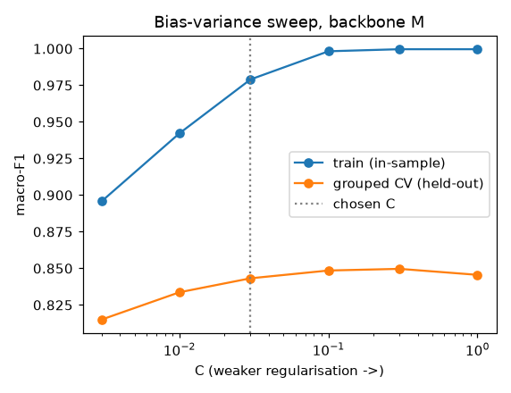
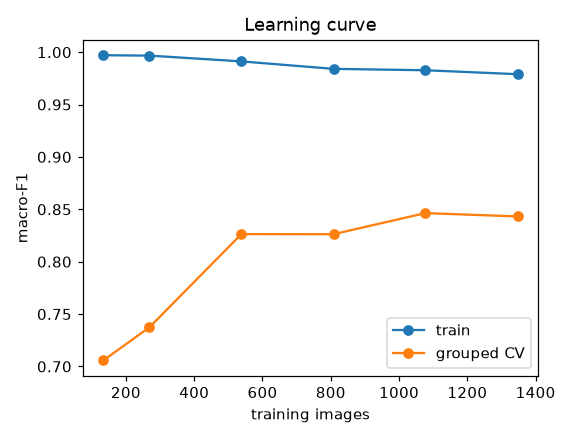
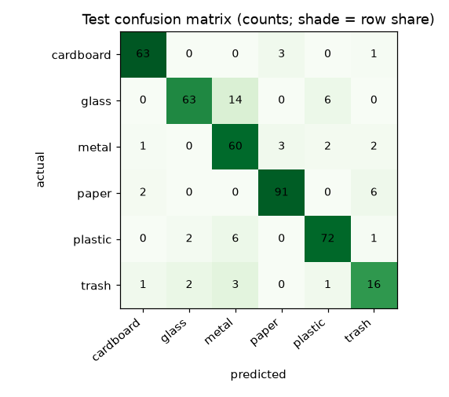
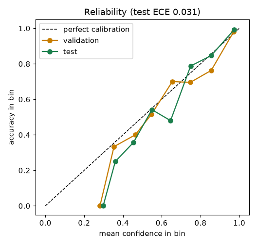
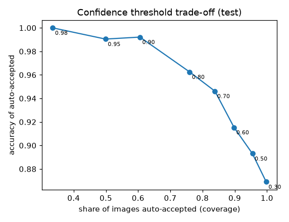
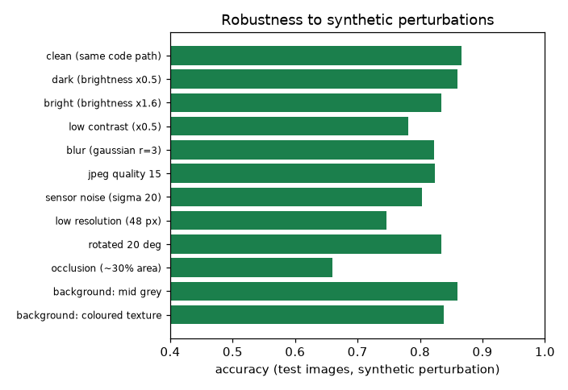

# Waste material classifier 1.0.0: evaluation report

Generated by `python -m ml.waste_classification.evaluation.report` from
`waste-classification-1.0.0.json` (the raw numbers). Protocol: `docs/ml/evaluation-protocol.md`.

**Summary.** On a held-out, group-aware test split (n = 421, evaluated once) the model reaches
**accuracy 0.867** (95% CI 0.813-0.912) and **macro-F1 0.841**
(CI 0.781-0.887). Its confidence is calibrated (mean confidence 0.869 vs accuracy
0.867; ECE 0.031). With the review rule, 74% of images are auto-accepted
at 96.1% accuracy and the rest go to a human. This is a score on *studio-style photographs*; it is not a field accuracy.

## 1. Data and split

TrashNet (`datasets/manifests/trashnet-1.0.yaml`): 2527 images, 6 material classes.
Near-duplicates (several photographs of one object) were clustered per class
(1477 groups, largest 35 images; 61% of images share a group), and a stratified group split was fixed
**before any modelling**: train 1684, validation 422, test 421. No group appears in two splits (checked in code).

| split | cardboard | glass | metal | paper | plastic | trash |
|---|---|---|---|---|---|---|
| train | 269 | 334 | 273 | 396 | 321 | 91 |
| validation | 67 | 84 | 69 | 99 | 80 | 23 |
| test | 67 | 83 | 68 | 99 | 81 | 23 |

**Leakage measured, not assumed.** The same recipe under a naive random split (ignoring groups) scores accuracy
0.893 / macro-F1 0.871, against 0.867 / 0.841 on the grouped test
split. 22.0% of naive-test images have a near-twin in training (same class, cosine similarity >= 0.80 (S backbone)),
against 2.1% with grouping. **Grouping reduces but does not eliminate similarity across the split**
(the residual is from the clustering threshold), so the test score may still be slightly optimistic.

## 2. Model and selection (train split only)

Frozen ImageNet-pretrained EfficientNet-EdgeTPU TFLite backbone -> L2-normalised features x10 -> multinomial
logistic regression (balanced class weights) -> temperature scaling. Training images are embedded under 4
orientation variants (identity, h-flip, v-flip, 90-degree rotation) as augmentation. Selection used 5-fold grouped CV on
the train split only; **C** by the one-standard-error rule (most regularised C within 1 SE of the best); then the *cheapest*
(backbone, TTA) pair within 1 SE of the best among those inside the 150 ms latency budget.

| backbone | TTA | CV macro-F1 | SEM | est. p95 ms | within latency budget |
|---|---|---|---|---|---|
| S | none | 0.830 | 0.016 | 8 | yes |
| S | flip | 0.837 | 0.017 | 17 | yes |
| S | flip4 | 0.845 | 0.015 | 34 | yes |
| M | none | 0.843 | 0.018 | 13 | yes |
| M | flip | 0.840 | 0.018 | 26 | yes |
| M | flip4 | 0.851 | 0.012 | 52 | yes |
| L | none | 0.839 | 0.010 | 36 | yes |
| L | flip | 0.843 | 0.013 | 72 | yes |
| L | flip4 | 0.849 | 0.014 | 145 | yes |
| M+L | none | 0.855 | 0.013 | 45 | yes |
| M+L | flip | 0.850 | 0.016 | 90 | yes |
| M+L | flip4 | 0.852 | 0.010 | 179 | no |

Selected: **backbone M, C = 0.03, TTA = none** (CV macro-F1 0.843 +/- 0.018).
Larger or combined backbones score slightly higher in CV, but the differences are about one standard error. The rule
was fixed before the results were seen and was not changed afterwards.

### Preprocessing ablation (`ml/waste_classification/experiments/preprocessing_ablation.py`)

Backbone M, C = 0.03, train only, grouped 5-fold CV, no augmentation. Run before the main pipeline to settle how a 4:3 photograph becomes a square input;
validation and test were not used.

| preprocessing | CV macro-F1 | SEM |
|---|---|---|
| centre-crop (shared preprocessing) | 0.836 | 0.015 |
| squash (distorting resize) | 0.824 | 0.020 |
| pad to square (white) | 0.802 | 0.020 |

### Baselines (must be beaten by a stated margin: +0.10 macro-F1)

| baseline | CV macro-F1 | validation macro-F1 | test macro-F1 |
|---|---|---|---|
| majority class (paper) | n/a | 0.063 | 0.063 |
| hand-crafted colour/gradient features + logistic regression | 0.582 | 0.574 | 0.592 |
| **selected model** | 0.843 | 0.821 | **0.841** |

Margin over the hand-crafted baseline on test: **+0.249** (required +0.10): met.

## 3. Over- and under-fitting diagnosis

| split | macro-F1 | accuracy |
|---|---|---|
| train (in-sample) | 0.976 | 0.980 |
| train, grouped 5-fold CV (held-out folds) | 0.843 | 0.866 |
| validation | 0.821 | 0.853 |
| **test (evaluated once)** | **0.841** | **0.867** |

- **No selection overfitting:** grouped CV (0.843), validation (0.821) and test (0.841) agree within their sampling noise, so
  hyper-parameter choice did not overfit the data it was tuned on.
- **There is a real generalisation gap:** the model fits its training images far better than unseen ones
  (train-minus-CV macro-F1 gap 0.136). This is the usual regime of a high-dimensional linear head on ~1.7k images.
  Regularisation (below) does not close it: weaker regularisation (C up to 0.3) trains to 1.0 and gains at most about one SE on held-out folds, stronger regularisation (C = 0.003) underfits.
- **Not underfitting:** train macro-F1 is 0.976, and a non-linear RBF-SVM on the same features scores
  0.857 vs 0.836 for the linear head (no augmentation; a difference of about one SE), so head capacity is not what limits accuracy.
- **Augmentation helps modestly:** CV macro-F1 0.843 with vs 0.836 without.

| C | train macro-F1 | CV macro-F1 | CV SEM | CV log-loss |
|---|---|---|---|---|
| 0.003 | 0.896 | 0.815 | 0.019 | 0.553 |
| 0.01 | 0.942 | 0.834 | 0.014 | 0.442 |
| 0.03 | 0.979 | 0.843 | 0.018 | 0.390 |
| 0.1 | 0.998 | 0.849 | 0.017 | 0.375 |
| 0.3 | 1.000 | 0.850 | 0.015 | 0.391 |
| 1 | 1.000 | 0.846 | 0.014 | 0.430 |

Low C underfits (train and CV both low); high C overfits (train -> 1.0, CV flat or falling). The chosen C = 0.03 is the *most regularised* value within one standard error of the best CV score
(C = 0.3), the pre-declared 1-SE rule: the same held-out performance with a simpler, less train-fitted head.

| training images | train macro-F1 | CV macro-F1 |
|---|---|---|
| 134 | 0.997 | 0.706 |
| 269 | 0.997 | 0.737 |
| 538 | 0.991 | 0.826 |
| 808 | 0.984 | 0.826 |
| 1077 | 0.983 | 0.846 |
| 1347 | 0.979 | 0.843 |

Held-out macro-F1 rises quickly and flattens over the last fractions while the train score stays near 1.0: **more images of the same kind
would help little; more *diverse* data (backgrounds, clutter, local items) is what is missing.**

## 4. Test results (evaluated once)

| metric | value |
|---|---|
| accuracy | 0.867 (95% CI 0.813-0.912, group bootstrap) |
| macro-F1 | 0.841 (95% CI 0.781-0.887) |
| top-2 accuracy | 0.971 |
| log-loss / Brier | 0.345 / 0.176 |

| class | precision | recall | F1 | support |
|---|---|---|---|---|
| cardboard | 0.940 | 0.940 | 0.940 | 67 |
| glass | 0.940 | 0.759 | 0.840 | 83 |
| metal | 0.723 | 0.882 | 0.795 | 68 |
| paper | 0.938 | 0.919 | 0.929 | 99 |
| plastic | 0.889 | 0.889 | 0.889 | 81 |
| trash | 0.615 | 0.696 | 0.653 | 23 |

| actual \ predicted | cardboard | glass | metal | paper | plastic | trash |
|---|---|---|---|---|---|---|
| cardboard | 63 | 0 | 0 | 3 | 0 | 1 |
| glass | 0 | 63 | 14 | 0 | 6 | 0 |
| metal | 1 | 0 | 60 | 3 | 2 | 2 |
| paper | 2 | 0 | 0 | 91 | 0 | 6 |
| plastic | 0 | 2 | 6 | 0 | 72 | 1 |
| trash | 1 | 2 | 3 | 0 | 1 | 16 |

The dominant error is **glass predicted as metal** and plastic as metal (reflective, similarly shaped containers); `trash` (n = 23) is the weakest class.

## 5. Calibration and the review rule

Temperature **T = 0.901** (fit on validation). T below 1 means the raw head was slightly *under*-confident.

| | ECE | log-loss | mean confidence |
|---|---|---|---|
| validation, raw | 0.033 | 0.379 | 0.847 |
| validation, calibrated | 0.030 | 0.376 | 0.865 |
| test, raw | 0.035 | 0.350 | 0.851 |
| test, calibrated | 0.031 | 0.345 | 0.869 |

**Review rule** (chosen on validation): flag for human review when calibrated confidence < **0.81**
(lowest threshold giving >= 95% accuracy on auto-accepted validation images; target met: True) or when the image's maximum
cosine similarity to the training images is < **0.570** (the least familiar 2% of validation images).

| split | auto-accepted | accuracy of auto-accepted (95% Wilson CI) | errors sent to review |
|---|---|---|---|
| validation | 73.2% | 95.1% (92.1%-97.0%) | 76% |
| **test** | 73.6% | **96.1%** (93.4%-97.8%) | 79% |

| threshold | auto-accepted | accuracy of auto-accepted |
|---|---|---|
| 0.30 | 99.8% | 86.9% |
| 0.50 | 95.5% | 89.3% |
| 0.60 | 89.8% | 91.5% |
| 0.70 | 83.8% | 94.6% |
| 0.80 | 76.0% | 96.2% |
| 0.90 | 60.6% | 99.2% |
| 0.95 | 49.9% | 99.0% |
| 0.98 | 33.5% | 100.0% |

"Higher confidence" is therefore a *choice of operating point*, not a property to maximise: raising the threshold raises the accuracy of what is auto-accepted and sends more to humans.

## 6. Robustness (synthetic proxies on the test images)

| condition | accuracy | macro-F1 | mean confidence | needs review | accuracy when auto-accepted |
|---|---|---|---|---|---|
| clean (same code path) | 0.867 | 0.841 | 0.869 | 26% | 0.961 |
| dark (brightness x0.5) | 0.860 | 0.835 | 0.830 | 36% | 0.952 |
| bright (brightness x1.6) | 0.834 | 0.812 | 0.823 | 41% | 0.940 |
| low contrast (x0.5) | 0.781 | 0.743 | 0.825 | 37% | 0.929 |
| blur (gaussian r=3) | 0.822 | 0.788 | 0.788 | 46% | 0.960 |
| jpeg quality 15 | 0.824 | 0.796 | 0.817 | 40% | 0.941 |
| sensor noise (sigma 20) | 0.803 | 0.776 | 0.803 | 45% | 0.940 |
| low resolution (48 px) | 0.746 | 0.721 | 0.735 | 56% | 0.930 |
| rotated 20 deg | 0.834 | 0.805 | 0.847 | 31% | 0.945 |
| occlusion (~30% area) | 0.660 | 0.638 | 0.765 | 49% | 0.817 |
| background: mid grey | 0.860 | 0.834 | 0.861 | 29% | 0.960 |
| background: coloured texture | 0.838 | 0.812 | 0.853 | 32% | 0.958 |

Occlusion, low resolution and low contrast hurt most. Under occlusion the model is **over-confident** (mean confidence above accuracy) and the review gate does not fully protect: auto-accepted accuracy falls.
Background replacement changed little, but it only replaces near-white pixels of studio photographs, so it is a weak proxy for real clutter.

## 7. Out-of-distribution inputs

Tiny, hand-picked set of NON-waste inputs (ImageNet-style photos and synthetic images); a smoke test, not a benchmark. 10 of 10 were routed to review. The same gates flag 2.1% of in-distribution test images by novelty alone
(and 25.2% by confidence).

| input | predicted | confidence | similarity to training set | needs review |
|---|---|---|---|---|
| photo: bird.bmp | cardboard | 0.43 | 0.28 | yes: low_confidence, unfamiliar_image |
| photo: cat.bmp | cardboard | 0.67 | 0.42 | yes: low_confidence, unfamiliar_image |
| photo: checker224X224.bmp | paper | 0.68 | 0.36 | yes: low_confidence, unfamiliar_image |
| photo: grace_hopper.bmp | paper | 0.75 | 0.43 | yes: low_confidence, unfamiliar_image |
| photo: parrot.jpg | paper | 0.45 | 0.30 | yes: low_confidence, unfamiliar_image |
| synthetic: blank white | glass | 0.47 | 0.39 | yes: low_confidence, unfamiliar_image |
| synthetic: blank black | trash | 0.46 | 0.28 | yes: low_confidence, unfamiliar_image |
| synthetic: mid grey | trash | 0.49 | 0.47 | yes: low_confidence, unfamiliar_image |
| synthetic: gaussian noise | cardboard | 0.91 | 0.56 | yes: unfamiliar_image |
| synthetic: colour blocks | paper | 0.70 | 0.35 | yes: low_confidence, unfamiliar_image |

This does **not** show the model can recognise unsupported *waste* (food scraps, e-waste, textiles, hazardous items), which was not tested because no labelled data was available.

## 8. Latency and train/serve parity

Single request, bytes -> decode -> 1 backbone pass(es) -> head -> calibration -> decision, x86_64, 2 CPU cores, no GPU, 2 interpreter threads, n = 120 test files:
**p50 23.1 ms, p95 29.6 ms, max 33.3 ms.** Parity of the serving code against the training-time features on 25 images:
max |logit difference| = 4.8e-06; identical predictions: True.

These timings come from a shared development sandbox (other jobs may have been running), so treat them as an order of magnitude, not a benchmark; the budget is 150 ms. Re-measure on the deployment hardware before relying on them.

## 9. Provenance

version `1.0.0`, git commit `12c93a5475d688407a14f5e8d5a0b1b4caaf965e` (training code tree clean at that commit: True), trained 2026-10-20T10:07:18Z, config SHA-256 `5898e145369a0b23868ee2c64be423e7f67fffc5338187dec7a32cd62ce9a4d2`, dataset content digest `73cfe75b6a3e1bf1d19632514006aad5c26944480f9364402003be9e567b5221`,
`model.json` SHA-256 `389d43164713196882f34480f94504f7cb57b8f68e73828ee49db29d91963102`, Python 3.11.2, numpy 2.4.6, scikit-learn 1.9.1.
Reproduce: `python -m ml.waste_classification.data.fetch && python -m ml.waste_classification.training.train && python -m ml.waste_classification.evaluation.report`.
