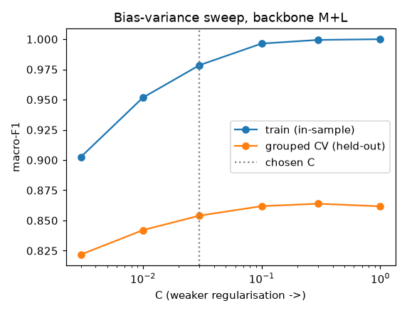
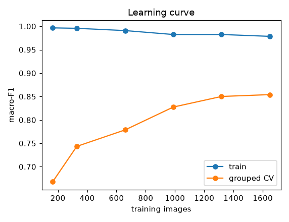
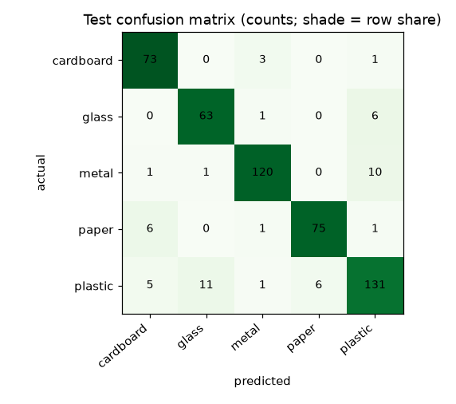
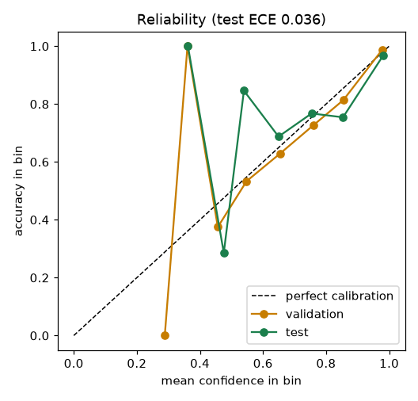
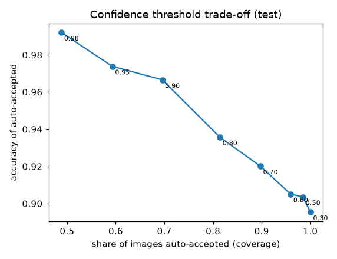
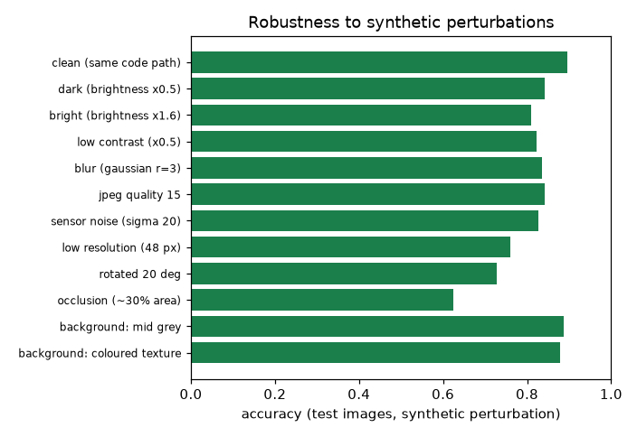

# Waste material classifier 2.0.0: evaluation report

Generated by `python -m ml.waste_classification.evaluation.report` from
`waste-classification-2.0.0.json` (the raw numbers). Protocol: `docs/ml/evaluation-protocol.md`.

**Summary.** On a held-out, group-aware test split (n = 516, evaluated once) the model reaches
**accuracy 0.895** (95% CI 0.855-0.931) and **macro-F1 0.896**
(CI 0.851-0.929). Its confidence is calibrated (mean confidence 0.907 vs accuracy
0.895; ECE 0.036). With the review rule, 83% of images are auto-accepted
at 93.5% accuracy and the rest go to a human. This is a score on one Australian facility's photographs; **it is not a field accuracy for Hyderabad.**

> **RESEARCH CANDIDATE, NOT APPROVED, NOT FOR RELEASE.** Trained only on realwaste 2.0, whose licence status is **conflicting** (declared: CC-BY-4.0, CC-BY-NC-SA-4.0); release allowed: False. Acceptance decision: **NOT APPROVED: offline criteria failed and no field evaluation exists**. Field evaluation done: False.
> TrashNet and TrashBox are excluded from this model's training, validation and test data.

### Acceptance criteria (set before the run; `ml/configs/waste_classification.yaml`)

| criterion | required | observed | result |
|---|---|---|---|
| test_macro_f1 | >= 0.8 | 0.896 | pass |
| min_class_recall | >= 0.6 | 0.851 | pass |
| ece | <= 0.08 | 0.036 | pass |
| margin_over_handcrafted_macro_f1 | >= 0.1 | 0.260 | pass |
| auto_accepted_accuracy_ci_low | >= 0.9 | 0.907 | pass |
| out_of_scope_review_rate | >= 0.9 | 0.797 | **FAIL** |
| Hyderabad field evaluation | >= 300 images, macro-F1 >= 0.75 | not done | **not met** |

Meeting the offline criteria would only make the model eligible for a field evaluation. No model is activated by this report.

## 1. Data and split

realwaste 2.0 (`datasets/manifests/realwaste-2.0.yaml`): 4752 files, of which 3092 are in the 5 trained material classes
and 1660 (catch-all, organic and textile folders) are out-of-scope evaluation input. Provenance gate passed: manifest complete, 0 files byte-identical to a TrashNet image
(SHA-256 denylist), 0 exact duplicate files, content digest `59fabef99c26bb25...` matches the manifest. Per-file table (hash, label, role, group): `datasets/manifests/realwaste-2.0.files.tsv` (4752 rows).
Near-duplicates (several photographs of one object) were clustered per class
(1390 groups, largest 72 images; 77% of images share a group), and a stratified group split was fixed
**before any modelling** (seed 42): train 2060, validation 516, test 516. No group appears in two splits and no byte-identical file straddles two splits (both checked in code).

| split | cardboard | glass | metal | paper | plastic |
|---|---|---|---|---|---|
| train | 307 | 280 | 527 | 333 | 613 |
| validation | 77 | 70 | 131 | 84 | 154 |
| test | 77 | 70 | 132 | 83 | 154 |

**Leakage measured, not assumed.** The same recipe under a naive random split (ignoring groups) scores accuracy
0.905 / macro-F1 0.904, against 0.895 / 0.896 on the grouped test
split. 31.8% of naive-test images have a near-twin in training (same class, cosine similarity >= 0.80 (S backbone)),
against 5.8% with grouping. **Grouping reduces but does not eliminate similarity across the split**
(the residual is from the clustering threshold), so the test score may still be slightly optimistic.

## 2. Model and selection (train split only)

Frozen ImageNet-pretrained EfficientNet-EdgeTPU TFLite backbone -> L2-normalised features x10 -> multinomial
logistic regression (balanced class weights) -> temperature scaling. Training images are embedded under 4
orientation variants (identity, h-flip, v-flip, 90-degree rotation) as augmentation. Selection used 5-fold grouped CV on
the train split only; **C** by the one-standard-error rule (most regularised C within 1 SE of the best); then the *cheapest*
(backbone, TTA) pair within 1 SE of the best among those inside the 150 ms latency budget.

| backbone | TTA | CV macro-F1 | SEM | est. p95 ms | within latency budget |
|---|---|---|---|---|---|
| S | none | 0.827 | 0.014 | 9 | yes |
| S | flip | 0.825 | 0.014 | 17 | yes |
| S | flip4 | 0.828 | 0.016 | 35 | yes |
| M | none | 0.831 | 0.017 | 14 | yes |
| M | flip | 0.836 | 0.019 | 28 | yes |
| M | flip4 | 0.844 | 0.017 | 55 | yes |
| L | none | 0.827 | 0.015 | 31 | yes |
| L | flip | 0.827 | 0.011 | 61 | yes |
| L | flip4 | 0.840 | 0.012 | 123 | yes |
| M+L | none | 0.854 | 0.014 | 43 | yes |
| M+L | flip | 0.860 | 0.015 | 86 | yes |
| M+L | flip4 | 0.860 | 0.010 | 172 | no |

Selected: **backbone M+L, C = 0.03, TTA = none** (CV macro-F1 0.854 +/- 0.014).
The rule picks the cheapest (backbone, TTA) pair within one standard error of the best CV score. It was fixed before
the results were seen and was not changed afterwards.

### Baselines (must be beaten by a stated margin: +0.10 macro-F1)

| baseline | CV macro-F1 | validation macro-F1 | test macro-F1 |
|---|---|---|---|
| majority class (plastic) | n/a | 0.092 | 0.092 |
| hand-crafted colour/gradient features + logistic regression | 0.620 | 0.660 | 0.636 |
| **selected model** | 0.854 | 0.878 | **0.896** |

Margin over the hand-crafted baseline on test: **+0.260** (required +0.10): met.

## 3. Over- and under-fitting diagnosis

| split | macro-F1 | accuracy |
|---|---|---|
| train (in-sample) | 0.976 | 0.975 |
| train, grouped 5-fold CV (held-out folds) | 0.854 | 0.857 |
| validation | 0.878 | 0.880 |
| **test (evaluated once)** | **0.896** | **0.895** |

- **Selection overfitting check:** grouped CV macro-F1 0.854, validation 0.878, test 0.896. A test score far below CV would indicate that tuning overfitted; read the gap from these three numbers.
- **Generalisation gap:** train (in-sample) macro-F1 0.976 against grouped-CV 0.854 (train-minus-CV gap 0.124).
- **Capacity probe:** a non-linear RBF-SVM on the same features scores 0.864 CV macro-F1 against 0.836 for the linear head (no augmentation).
- **Augmentation:** CV macro-F1 0.854 with vs 0.836 without.

| C | train macro-F1 | CV macro-F1 | CV SEM | CV log-loss |
|---|---|---|---|---|
| 0.003 | 0.903 | 0.822 | 0.015 | 0.594 |
| 0.01 | 0.952 | 0.842 | 0.015 | 0.473 |
| 0.03 | 0.979 | 0.854 | 0.014 | 0.410 |
| 0.1 | 0.996 | 0.862 | 0.014 | 0.382 |
| 0.3 | 0.999 | 0.864 | 0.013 | 0.386 |
| 1 | 1.000 | 0.862 | 0.016 | 0.420 |

The chosen C = 0.03 is the *most regularised* value within one standard error of the best CV score (the pre-declared 1-SE rule).

| training images | train macro-F1 | CV macro-F1 |
|---|---|---|
| 164 | 0.997 | 0.668 |
| 329 | 0.996 | 0.743 |
| 659 | 0.991 | 0.779 |
| 988 | 0.982 | 0.827 |
| 1318 | 0.982 | 0.850 |
| 1648 | 0.979 | 0.854 |

The learning curve plots held-out macro-F1 against the share of training data used; whether more data of the same kind would help is read from its slope and is not asserted here.

## 4. Test results (evaluated once)

| metric | value |
|---|---|
| accuracy | 0.895 (95% CI 0.855-0.931, group bootstrap) |
| macro-F1 | 0.896 (95% CI 0.851-0.929) |
| top-2 accuracy | 0.984 |
| log-loss / Brier | 0.317 / 0.169 |

| class | precision | recall | F1 | support |
|---|---|---|---|---|
| cardboard | 0.859 | 0.948 | 0.901 | 77 |
| glass | 0.840 | 0.900 | 0.869 | 70 |
| metal | 0.952 | 0.909 | 0.930 | 132 |
| paper | 0.926 | 0.904 | 0.915 | 83 |
| plastic | 0.879 | 0.851 | 0.865 | 154 |

| actual \ predicted | cardboard | glass | metal | paper | plastic |
|---|---|---|---|---|---|
| cardboard | 73 | 0 | 3 | 0 | 1 |
| glass | 0 | 63 | 1 | 0 | 6 |
| metal | 1 | 1 | 120 | 0 | 10 |
| paper | 6 | 0 | 1 | 75 | 1 |
| plastic | 5 | 11 | 1 | 6 | 131 |

The most frequent confusions on the test split: plastic predicted as glass (11 images); metal predicted as plastic (10 images). The weakest class by F1 is **plastic** (F1 0.865).

## 5. Calibration and the review rule

Temperature **T = 0.750** (fit on validation). T below 1 means the raw head was under-confident, above 1 over-confident.

| | ECE | log-loss | mean confidence |
|---|---|---|---|
| validation, raw | 0.050 | 0.334 | 0.837 |
| validation, calibrated | 0.021 | 0.317 | 0.883 |
| test, raw | 0.032 | 0.319 | 0.864 |
| test, calibrated | 0.036 | 0.317 | 0.907 |

**Review rule** (chosen on validation): flag for human review when calibrated confidence < **0.75**
(lowest threshold giving >= 95% accuracy on auto-accepted validation images; target met: True) or when the image's maximum
cosine similarity to the training images is < **0.620** (the novelty quantile set in the config, applied to validation images only).

| split | auto-accepted | accuracy of auto-accepted (95% Wilson CI) | errors sent to review |
|---|---|---|---|
| validation | 79.7% | 95.1% (92.6%-96.8%) | 68% |
| **test** | 82.9% | **93.5%** (90.7%-95.4%) | 48% |

| threshold | auto-accepted | accuracy of auto-accepted |
|---|---|---|
| 0.30 | 100.0% | 89.5% |
| 0.50 | 98.4% | 90.4% |
| 0.60 | 95.9% | 90.5% |
| 0.70 | 89.7% | 92.0% |
| 0.80 | 81.4% | 93.6% |
| 0.90 | 69.6% | 96.7% |
| 0.95 | 59.3% | 97.4% |
| 0.98 | 48.8% | 99.2% |

"Higher confidence" is therefore a *choice of operating point*, not a property to maximise: raising the threshold raises the accuracy of what is auto-accepted and sends more to humans.

## 6. Robustness (synthetic proxies on the test images)

| condition | accuracy | macro-F1 | mean confidence | needs review | accuracy when auto-accepted |
|---|---|---|---|---|---|
| clean (same code path) | 0.895 | 0.896 | 0.907 | 17% | 0.935 |
| dark (brightness x0.5) | 0.843 | 0.846 | 0.879 | 25% | 0.907 |
| bright (brightness x1.6) | 0.810 | 0.807 | 0.872 | 27% | 0.901 |
| low contrast (x0.5) | 0.822 | 0.824 | 0.868 | 25% | 0.894 |
| blur (gaussian r=3) | 0.835 | 0.837 | 0.854 | 30% | 0.928 |
| jpeg quality 15 | 0.843 | 0.844 | 0.870 | 25% | 0.904 |
| sensor noise (sigma 20) | 0.828 | 0.827 | 0.877 | 25% | 0.895 |
| low resolution (48 px) | 0.760 | 0.754 | 0.815 | 44% | 0.879 |
| rotated 20 deg | 0.729 | 0.727 | 0.828 | 43% | 0.860 |
| occlusion (~30% area) | 0.624 | 0.621 | 0.795 | 51% | 0.733 |
| background: mid grey | 0.888 | 0.889 | 0.897 | 20% | 0.933 |
| background: coloured texture | 0.878 | 0.879 | 0.890 | 20% | 0.922 |

The two background perturbations only replace near-white pixels, so on photographs without a white background they change almost nothing and are **not** evidence of robustness to clutter.
These are synthetic proxies; none of them substitutes for field photographs.

## 7. Out-of-scope waste and out-of-distribution inputs

### 7a. Waste the model has no class for (RealWaste folders mapped to no EcoMind class)

source folders with no EcoMind class (catch-all, organic, textile). 'predicted_as' is what the model would say without the review rule; they are never counted as errors.

| source folder | images | sent to review | what it would be called without the review rule |
|---|---|---|---|
| Food Organics | 411 | 83.9% | cardboard 75, glass 2, metal 144, paper 21, plastic 169 |
| Miscellaneous Trash | 495 | 68.3% | cardboard 87, glass 19, metal 155, paper 97, plastic 137 |
| Textile Trash | 318 | 72.3% | cardboard 52, metal 46, paper 168, plastic 52 |
| Vegetation | 436 | 94.0% | cardboard 44, glass 5, metal 85, paper 112, plastic 190 |

Overall **79.7%** of 1660 out-of-scope images were sent to a person (low confidence on 1016, unfamiliar image on 958; an image can trigger both). The remainder would have been shown as a material suggestion.

### 7b. Unrelated photographs (smoke test)

Tiny, hand-picked set of NON-waste inputs (ImageNet-style photos and synthetic images); a smoke test, not a benchmark. 10 of 10 were routed to review. The same gates flag 3.1% of in-distribution test images by novelty alone
(and 14.3% by confidence).

| input | predicted | confidence | similarity to training set | needs review |
|---|---|---|---|---|
| photo: bird.bmp | metal | 0.75 | 0.28 | yes: unfamiliar_image |
| photo: cat.bmp | metal | 0.78 | 0.28 | yes: unfamiliar_image |
| photo: checker224X224.bmp | cardboard | 0.73 | 0.31 | yes: low_confidence, unfamiliar_image |
| photo: grace_hopper.bmp | cardboard | 0.43 | 0.37 | yes: low_confidence, unfamiliar_image |
| photo: parrot.jpg | paper | 0.61 | 0.27 | yes: low_confidence, unfamiliar_image |
| synthetic: blank white | cardboard | 0.83 | 0.24 | yes: unfamiliar_image |
| synthetic: blank black | cardboard | 0.34 | 0.23 | yes: low_confidence, unfamiliar_image |
| synthetic: mid grey | cardboard | 0.43 | 0.31 | yes: low_confidence, unfamiliar_image |
| synthetic: gaussian noise | cardboard | 0.38 | 0.38 | yes: low_confidence, unfamiliar_image |
| synthetic: colour blocks | cardboard | 0.81 | 0.33 | yes: unfamiliar_image |

The ten-input smoke set is not a measurement. E-waste and hazardous items were not tested (no labelled data).

## 8. Latency and train/serve parity

Single request, bytes -> decode -> 1 backbone pass(es) -> head -> calibration -> decision, x86_64, 2 CPU cores, no GPU, 2 interpreter threads, n = 120 test files:
**p50 74.8 ms, p95 90.1 ms, max 101.2 ms.** Parity of the serving code against the training-time features on 25 images:
max |logit difference| = 5.7e-06; identical predictions: True.

These timings come from a shared development sandbox (other jobs may have been running), so treat them as an order of magnitude, not a benchmark; the budget is 150 ms. Re-measure on the deployment hardware before relying on them.

## 9. Provenance

version `2.0.0`, git commit `430e027daf5f59b746d002a0a0c2f71eac150b41` (training code tree clean at that commit: True), trained 2026-10-22T09:07:57Z, config SHA-256 `120bce10aad632eca1b8e8db9d08be9dedae9e985efcd9f79a50dbca65e370e8`, dataset content digest `59fabef99c26bb25afb86b718981e6fc6e04b6bcba6bd39de5834ee668f432ef`,
`model.json` SHA-256 `580d6cce168a55f867c0e7bd279b2fb72c1975a872b42b59f714e2b892fdc354`, Python 3.11.2, numpy 2.4.6, scikit-learn 1.9.1.
Reproduce: `python -m ml.waste_classification.data.fetch && python -m ml.waste_classification.training.train && python -m ml.waste_classification.evaluation.report`.
